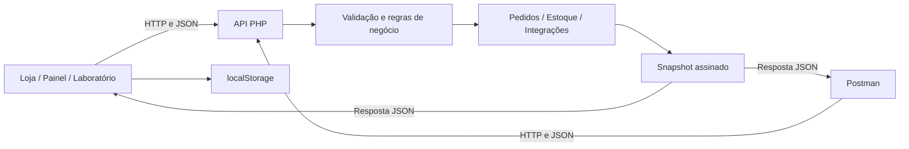

# CommerceOps Lab

Laboratório interativo de e-commerce, desenvolvido para explorar e reforçar conceitos de desenvolvimento de software, integração de sistemas e regras de negócio. A aplicação permite acompanhar uma compra desde o catálogo até a entrega e testar as operações HTTP que sustentam esse fluxo.

[**Acessar o laboratório**](https://commerceops-lab.vercel.app) · [Documentação da API](docs/API.md) · [Coleção Postman](postman/CommerceOps.postman_collection.json)

> Ambiente educacional independente. Produtos, pedidos, pagamentos, fretes e integrações comerciais são simulados. Não há cobranças reais.

## Visão geral

O CommerceOps reúne três ambientes complementares:

| Ambiente | Finalidade |
| --- | --- |
| [Loja virtual](https://commerceops-lab.vercel.app/#store) | Explorar o catálogo, pesquisar produtos, montar o carrinho e concluir uma compra simulada. |
| [Painel de gestão](https://commerceops-lab.vercel.app/#dashboard) | Acompanhar pedidos, receita, ticket médio, estoque, pagamentos, expedição e eventos. |
| [Laboratório de APIs](https://commerceops-lab.vercel.app/#api) | Entender métodos HTTP, editar payloads JSON, executar requisições e interpretar respostas do backend. |

## Funcionalidades

- Catálogo com categorias, pesquisa, ordenação e detalhes dos produtos.
- Checkout com validação de disponibilidade, cupom e cálculo de frete simulado.
- Criação de pedidos e reserva de estoque no backend.
- Aprovação e recusa de pagamentos simulados; nova tentativa e tratamento de eventos duplicados dentro da sessão.
- Controle do ciclo de pedidos: pagamento, expedição, entrega e cancelamento de pedidos pendentes.
- Atualização de saldo e devolução de unidades ao cancelar pedidos pendentes.
- Simulação de sincronização de catálogo com marketplace e falhas de integração.
- Indicadores de gestão, eventos de negócio e registro de requisições no frontend.
- Documentação interativa e coleção de testes de API para Postman.

## Tecnologias

| Camada | Tecnologia |
| --- | --- |
| Interface | HTML5, CSS3, Bootstrap 5 e JavaScript |
| Comunicação | Fetch API, HTTP e JSON |
| Backend | PHP 8.4 |
| Estado | Snapshot JSON assinado com HMAC-SHA256; armazenamento local do token no navegador |
| Testes | Postman Collection Runner e script Python de testes HTTP |
| Publicação | Git, GitHub e Vercel Functions com runtime comunitário `vercel-php` |

## Arquitetura



O frontend não determina preços finais, descontos ou disponibilidade de estoque. A API valida a requisição, aplica as regras de negócio e devolve o estado resultante. Cada cliente mantém seu próprio snapshot de sessão, enviado de volta nas operações seguintes.

A aplicação utiliza uma API HTTP/JSON orientada a ações, por meio de `api/index.php?action=...`. A separação entre frontend e backend permite utilizar a mesma API no navegador e no Postman.

## Executar localmente

**Pré-requisitos:** PHP 8.4 e, opcionalmente, Python 3 para os testes HTTP. Não há instalação de dependências npm ou Composer.

1. Clone ou baixe o repositório e abra o terminal na raiz do projeto.
2. Configure uma chave de sessão (recomendado). No PowerShell:

   ```powershell
   $env:DEMO_SECRET = php -r 'echo bin2hex(random_bytes(32));'
   ```

   Em Bash:

   ```bash
   export DEMO_SECRET="$(php -r 'echo bin2hex(random_bytes(32));')"
   ```

3. Inicie o servidor no mesmo terminal:

   ```bash
   php -S localhost:8000
   ```

4. Acesse [http://localhost:8000](http://localhost:8000).

A API precisa estar em execução; abrir `index.html` diretamente ou usar somente Live Server não é suficiente. O arquivo `.env.example` documenta a variável, mas a aplicação não possui carregador automático de arquivos `.env`.

## Publicação no Vercel

O arquivo `vercel.json` configura `api/index.php` com o runtime comunitário `vercel-php@0.8.0`. Esse runtime não é um runtime oficial do Vercel.

1. Importe o repositório no Vercel, com a raiz do projeto como diretório principal e Framework Preset **Other**.
2. Não configure um comando de build adicional.
3. Em **Settings → Environment Variables**, defina `DEMO_SECRET` com uma chave aleatória privada, por exemplo de 64 caracteres hexadecimais. Não publique esse valor no GitHub.
4. Realize o deploy ou redeploy.
5. Verifique a API em `/api/index.php?action=health`. O resultado esperado é HTTP 200 e `ok: true`.

Sem a variável, o código utiliza uma chave pública de demonstração, que não oferece proteção efetiva contra adulteração. Consulte [vercel-community/php](https://github.com/vercel-community/php) para informações sobre o runtime.

## Experimentar o fluxo de compra

1. Abra a loja e adicione um Headphone Studio ao carrinho.
2. Informe o CEP fictício `89160-000` e aplique `DEMO10`.
3. Confira o cálculo: subtotal R$ 249,90, desconto R$ 24,99, frete R$ 12,90 e total R$ 237,81.
4. Crie o pedido e observe a reserva de estoque.
5. No painel de pedidos, simule uma recusa e depois uma aprovação de pagamento. Reenvie o evento de aprovação para verificar o tratamento de duplicatas.
6. Expeça e confirme a entrega. Observe os indicadores e os eventos de negócio.
7. Em Integrações, simule uma falha de sincronização; depois reproduza operações no Laboratório de APIs.

## Testes de API

### Postman

Importe [a coleção](postman/CommerceOps.postman_collection.json) e confira a variável `baseUrl`:

- Publicado: `https://commerceops-lab.vercel.app`
- Local: `http://localhost:8000`

Execute **Run collection**, na ordem original, com uma iteração. As 17 requisições possuem scripts para encadear token e identificadores. A sessão do Postman é independente da sessão do navegador. Algumas requisições esperam códigos de erro para validar regras de negócio.

### Testes HTTP via Python

Com a aplicação em execução:

```bash
python tests/smoke.py
```

Para testar o ambiente publicado:

```bash
python tests/smoke.py https://commerceops-lab.vercel.app
```

O [relatório local incluído no projeto](tests/resultado-local.txt) registra 25 requisições verificadas, cobrindo checkout, estoque, pagamento, eventos duplicados, expedição, cancelamento, integração e erros de entrada. Esse resultado é do script de testes local, não de uma execução completa do Postman no ambiente publicado.

## Estrutura do projeto

```text
.
├── api/
│   └── index.php                         # API e regras de negócio
├── assets/
│   ├── app.js                            # Interface e comunicação HTTP
│   ├── style.css                         # Estilos
│   ├── bootstrap.min.css                 # Bootstrap local
│   └── products/                         # Ilustrações de fallback
├── docs/
│   └── API.md                            # Contrato e exemplos da API
├── postman/
│   └── CommerceOps.postman_collection.json
├── tests/
│   ├── smoke.py
│   └── resultado-local.txt
├── index.html
├── vercel.json
├── .env.example
├── .gitignore
└── README.md
```

## Limites do laboratório e próximos passos

Esta implementação prioriza a experimentação sem dependência de serviços comerciais ou banco de dados externo. O snapshot é assinado, mas não criptografado; não representa autenticação nem autorização de usuários. Não utilize dados pessoais reais. O estado não é compartilhado de forma transacional entre clientes, pode ser reproduzido a partir de snapshots anteriores e não possui controle global de concorrência ou idempotência. O limite é de 60 pedidos por sessão, incluindo os iniciais.

Para evoluir o projeto em direção a uma arquitetura de produção, seriam necessárias persistência transacional, autenticação e autorização, validação de assinatura de webhooks externos, idempotência persistente, filas, observabilidade centralizada e integrações comerciais reais. Emissão fiscal, estornos e cancelamento de pedidos pagos não estão implementados.

## Créditos

Bootstrap é distribuído sob licença MIT. O aviso de licença está preservado no arquivo CSS. Fotografias ilustrativas são carregadas via Pexels, com fallback para artes vetoriais locais. Referências: [banner](https://www.pexels.com/photo/a-computer-monitor-headphones-and-mouse-on-a-desk-27559555/), [headphones](https://www.pexels.com/photo/black-studio-headphones-on-white-background-30428610/), [teclado](https://www.pexels.com/photo/modern-black-mechanical-keyboard-on-wooden-desk-36203655/), [mouse](https://www.pexels.com/photo/close-up-of-a-modern-white-wireless-mouse-32755767/). A experiência de compra utiliza referências de navegação e apresentação de lojas virtuais, sem associação com elas.

Projeto de estudo e portfólio. Sugestões e contribuições são bem-vindas por meio das Issues do repositório.
