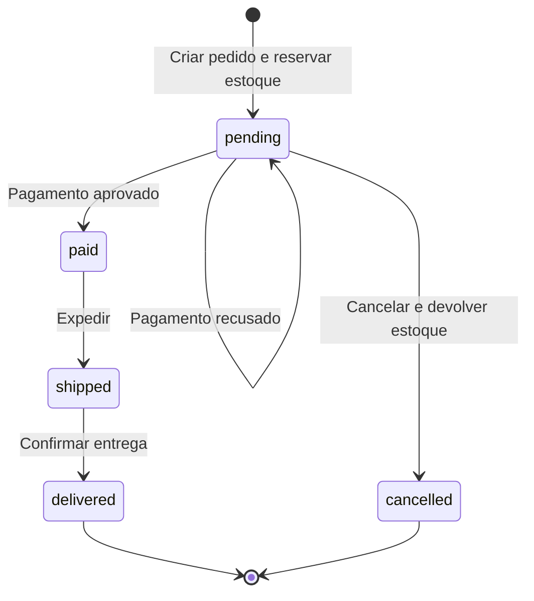

# CommerceOps Lab — Referência da API

[Voltar ao README](../README.md) · [Laboratório interativo](https://commerceops-lab.vercel.app/#api) · [Coleção Postman](../postman/CommerceOps.postman_collection.json)

## 1. Visão geral

A API PHP do CommerceOps implementa operações de comércio eletrônico sobre HTTP/JSON: consulta de estado, cálculo de checkout, criação de pedidos, atualização de estoque, processamento de pagamentos simulados, expedição e sincronização de catálogo.

| Ambiente | URL base |
| --- | --- |
| Publicado | `https://commerceops-lab.vercel.app` |
| Local | `http://localhost:8000` |

Todas as operações utilizam `/api/index.php?action=<ação>`. Trata-se de uma API HTTP orientada a ações, não de uma API REST estritamente organizada por recursos. O parâmetro `action` assume `health` quando omitido.

Para requisições com corpo, envie `Content-Type: application/json`. O servidor retorna JSON UTF-8 e `Cache-Control: no-store`.

## 2. Sessão e formato das respostas

### Como iniciar uma sessão

1. Execute `GET /api/index.php?action=bootstrap`.
2. Copie o campo `token` da resposta.
3. Envie esse valor como `_demoToken` no JSON de cada operação que exige sessão. Alternativamente, utilize o cabeçalho `X-Demo-State` (preferível apenas para tokens pequenos).
4. Nas respostas bem-sucedidas que incluem um novo `token`, substitua o anterior pelo novo valor. Reutilizar um token antigo pode retornar a um estado anterior.

A assinatura HMAC-SHA256 protege a integridade do snapshot quando `DEMO_SECRET` é privado. O conteúdo é codificado em Base64, não criptografado. Não é um token de autenticação e não há controle de acesso a usuários. O Postman e o navegador operam em sessões independentes.

**No Postman:** `{{baseUrl}}`, `{{demoToken}}` e `{{orderId}}` são variáveis da coleção. Nos exemplos abaixo, `{{demoToken}}` deve conter o token mais recente. Os scripts da coleção atualizam as variáveis automaticamente.

### Respostas bem-sucedidas

Exemplo de resposta de `health` (valores de runtime e latência ilustrativos):

```json
{
  "ok": true,
  "data": {
    "service": "CommerceOps API",
    "runtime": "8.4.27",
    "mode": "sandbox",
    "status": "ok"
  },
  "meta": {
    "action": "health",
    "elapsed_ms": 0.12
  }
}
```

Nas operações de sessão, a resposta também inclui `state` (estado completo) e `token` (snapshot assinado atualizado). `data` contém o resultado específico da operação; em `bootstrap` e `state`, é um array vazio (`[]`). O estado contém `version`, `products`, `orders`, `events` e `next`. As datas são strings ISO 8601 em UTC. Os valores monetários são **inteiros em centavos** (por exemplo, `24990` equivale a R$ 249,90).

### Respostas de erro

```json
{
  "ok": false,
  "error": "Estoque insuficiente para Headphone Studio."
}
```

Respostas de erro não retornam um novo snapshot; mantenha o último token válido. A mensagem é voltada à leitura humana, sem código de erro de negócio separado.

## 3. Índice dos endpoints

| Método | `action` | Sessão | Sucesso HTTP | Finalidade |
| --- | --- | --- | --- | --- |
| GET | [health](#health) | Não | 200 | Disponibilidade do serviço |
| GET | [bootstrap](#bootstrap) | Não | 200 | Inicializar sessão de demonstração |
| POST | [state](#state) | Sim | 200 | Consultar estado |
| POST | [quote](#quote) | Sim | 200 | Calcular checkout |
| POST | [orders](#orders) | Sim | 201 | Criar pedido |
| PATCH | [stock](#stock) | Sim | 200 | Atualizar estoque |
| POST | [webhook](#webhook) | Sim | 200 | Processar pagamento simulado |
| PATCH | [fulfillment](#fulfillment) | Sim | 200 | Atualizar etapa do pedido |
| POST | [sync](#sync) | Sim | 200 | Simular integração |

## 4. Operações

### health

`GET /api/index.php?action=health`

Verifica se o serviço PHP responde. Não recebe corpo nem exige token. Retorna `data.service`, `data.runtime`, `data.mode` e `data.status`, conforme o exemplo da seção 2. HTTP 200 indica que essa operação respondeu; não constitui uma verificação de serviços externos.

**Experimento:** abra [o endpoint publicado](https://commerceops-lab.vercel.app/api/index.php?action=health) ou envie a requisição no Postman.

### bootstrap

`GET /api/index.php?action=bootstrap`

Inicializa uma nova sessão com seis SKUs, quatro pedidos fictícios e o evento `system.ready`. Não recebe corpo. Retorna HTTP 200, `data: []`, `state` e `token`.

**Experimento:** localize `state.products`, `state.orders` e `token`. Salve o token para o próximo passo. Executar novamente inicializa outro snapshot; não altera uma sessão já existente no navegador.

### state

`POST /api/index.php?action=state`

Consulta o snapshot fornecido, sem modificar os dados de negócio.

```json
{
  "_demoToken": "{{demoToken}}"
}
```

Retorna HTTP 200, `data: []`, `state` e `token`. Não existe banco de dados central por trás dessa consulta. O método POST foi escolhido para transportar o snapshot no corpo da requisição; a operação é de leitura.

### quote

`POST /api/index.php?action=quote`

Valida produtos, quantidades, CEP e cupom; calcula os totais sem reservar estoque.

```json
{
  "items": [{"id": "SKU-101", "qty": 1}],
  "cep": "89160-000",
  "coupon": "DEMO10",
  "_demoToken": "{{demoToken}}"
}
```

| Campo | Tipo | Regra |
| --- | --- | --- |
| `items` | array | 1 a 20 entradas |
| `items[].id` | string | SKU existente, até 32 bytes |
| `items[].qty` | inteiro | 1 a 99 por entrada; SKUs repetidos são somados para validar saldo |
| `cep` | string | Até 12 bytes, deve conter exatamente oito dígitos após normalização |
| `coupon` | string opcional | Vazio ou `DEMO10` (10% de desconto) |

Resultado HTTP 200; exemplo do campo `data` em uma sessão inicial:

```json
{
  "items": [{"id": "SKU-101", "name": "Headphone Studio", "qty": 1, "price": 24990}],
  "subtotal": 24990,
  "discount": 2499,
  "shipping": 1290,
  "total": 23781,
  "cep": "89160000"
}
```

Regras de frete simulado: R$ 12,90 para CEP iniciado por `89`, R$ 24,90 nos demais casos e frete grátis se o subtotal após desconto atingir R$ 500,00. O desconto usa divisão inteira em centavos. Não há consulta externa de CEP, endereço ou transportadora.

**Erros:** 404 para SKU inexistente; 409 para saldo insuficiente; 422 para carrinho, quantidade, CEP ou cupom inválidos.

### orders

`POST /api/index.php?action=orders`

Cria um pedido pendente após validar o checkout no servidor. Reserva o estoque reduzindo o saldo disponível e emite `order.created`.

```json
{
  "customer": "Cliente Demo",
  "items": [{"id": "SKU-101", "qty": 1}],
  "cep": "89160-000",
  "coupon": "DEMO10",
  "channel": "Loja virtual",
  "_demoToken": "{{demoToken}}"
}
```

Além dos campos de `quote`, requer `customer` (string não vazia de até 80 bytes) e aceita `channel` opcional (`Loja virtual`, padrão, ou `Marketplace`). Preços e totais são calculados pelo servidor, não confiados ao cliente.

Retorna **HTTP 201 Created**. `data.order` contém `id`, `customer`, `cep`, `items`, `subtotal`, `discount`, `shipping`, `total`, `status`, `payment`, `tracking`, `channel`, `created` e `history`. O primeiro novo pedido após `bootstrap` é `ORD-1005`, com `status: pending`, `payment: pending` e `tracking: null`.

**Experimento:** salve `data.order.id` em `orderId`, observe a redução do estoque e tente criar outro pedido com quantidade superior ao saldo. O conflito retorna 409. O limite de 60 pedidos por sessão também retorna 409. As validações de `quote` continuam aplicáveis.

### stock

`PATCH /api/index.php?action=stock`

Atualiza o saldo disponível de um SKU para um valor absoluto. Não soma nem subtrai o valor enviado.

```json
{
  "id": "SKU-104",
  "stock": 12,
  "_demoToken": "{{demoToken}}"
}
```

`id`: SKU existente (string de até 32 bytes). `stock`: inteiro de 0 a 9999. HTTP 200, com `data.product` contendo o produto atualizado. Emite `stock.updated`.

**Experimento:** atualize o saldo para 12 e depois envie `stock: -1`. O valor negativo deve retornar 422; SKU inexistente retorna 404.

### webhook

`POST /api/index.php?action=webhook`

Simula um evento de gateway de pagamento. Um webhook é uma notificação enviada por um sistema a outro quando ocorre um evento; neste laboratório, a chamada é manual, sem provedor financeiro real.

```json
{
  "orderId": "{{orderId}}",
  "result": "approved",
  "eventId": "payment-demo-001",
  "_demoToken": "{{demoToken}}"
}
```

| Campo | Tipo | Regra |
| --- | --- | --- |
| `orderId` | string | Pedido existente, até 32 bytes |
| `result` | string | `approved` ou `failed` |
| `eventId` | string | Identificador não vazio do evento, até 80 bytes |

HTTP 200 com `data.duplicate` (booleano) e `data.order`. A aprovação altera `status` para `paid` e `payment` para `approved`. A recusa mantém `status: pending`, define `payment: failed` e permite nova tentativa com outro `eventId`.

Reenviar o mesmo `eventId`, pedido e resultado com o snapshot mais recente retorna `duplicate: true`, sem registrar novo evento nem reaplicar a transição. Reutilizar um ID com conteúdo diferente, ou processar um novo evento em pedido que não está pendente, retorna 409. Pedido inexistente retorna 404; campos inválidos, 422.

**Experimento:** envie uma recusa com `eventId` diferente, aprove o pedido e repita exatamente a aprovação. Observe `duplicate` na resposta. A deduplicação é limitada ao histórico do snapshot; não é idempotência global. Não há autenticação de webhooks externos.

### fulfillment

`PATCH /api/index.php?action=fulfillment`

Atualiza o estágio logístico ou cancela um pedido pendente.

```json
{
  "orderId": "{{orderId}}",
  "status": "shipped",
  "_demoToken": "{{demoToken}}"
}
```

`orderId` deve identificar um pedido existente; `status` deve ser uma string correspondente a uma transição permitida. Retorna HTTP 200 e `data.order` atualizado, com histórico e evento `order.<status>`.

| Origem | Destino permitido | Efeito |
| --- | --- | --- |
| `pending` | `cancelled` | Devolve unidades ao estoque e marca pagamento como cancelado |
| `paid` | `shipped` | Gera rastreio fictício `SIM-<número>` |
| `shipped` | `delivered` | Confirma entrega |
| `delivered` / `cancelled` | Nenhum | Estados finais |

**Experimento:** tente expedir um pedido pendente (409), aprove o pagamento via `webhook`, expeça e confirme a entrega. Para validar a devolução de estoque, crie outro pedido e cancele-o antes da aprovação. Não há cancelamento de pedidos pagos, estorno ou rastreamento externo. Pedido inexistente retorna 404; transição não permitida, 409.

### sync

`POST /api/index.php?action=sync`

Simula o resultado de uma sincronização de catálogo com marketplace.

```json
{
  "result": "error",
  "_demoToken": "{{demoToken}}"
}
```

`result` aceita `success` ou `error`. HTTP 200 em ambos os casos válidos, pois a API processou corretamente a solicitação de simulação. O evento `marketplace.sync` registra o resultado com nível `success` ou `error`.

Exemplo de `data` em falha simulada:

```json
{"synced": 0, "simulated": true}
```

No sucesso, `synced` informa a quantidade de produtos do catálogo (seis no estado inicial). Em ambos os casos `simulated` é `true`. Um valor de `result` inválido retorna 422. Não há chamada a marketplace real nem timeout HTTP provocado pela aplicação.

**Experimento:** compare o evento registrado e o campo `synced` nos cenários de sucesso e erro. Diferencie falha de negócio simulada de erro HTTP.

## 5. Ciclo de vida do pedido



## 6. Códigos HTTP e limites

| Código | Significado no laboratório |
| --- | --- |
| 200 OK | Operação processada com sucesso, inclusive simulação de falha de integração |
| 201 Created | Novo pedido criado |
| 400 Bad Request | JSON inválido ou formato de corpo não aceito |
| 401 Unauthorized | Token ausente, assinatura inválida ou estado de sessão rejeitado |
| 404 Not Found | Ação, SKU ou pedido inexistente |
| 405 Method Not Allowed | Método incompatível com a ação; retorna cabeçalho `Allow` |
| 409 Conflict | Estoque insuficiente, transição inválida, evento conflitante ou limite de pedidos |
| 413 Content Too Large | Corpo superior a 1.000.000 bytes ou token superior a 500.000 bytes |
| 422 Unprocessable Content | Campo ou regra de entrada inválida |
| 500 Internal Server Error | Erro inesperado do servidor |

Além desses limites, o histórico de eventos de negócio mantém os 100 eventos mais recentes. O estado comporta até 60 pedidos, incluindo os pedidos iniciais.

## 7. Roteiro de testes no Postman

Importe `postman/CommerceOps.postman_collection.json`. Configure `baseUrl` sem barra final e execute a coleção na ordem, com uma iteração.

| Nº | Cenário | HTTP esperado |
| ---: | --- | ---: |
| 01 | Health check | 200 |
| 02 | Inicializar sessão | 200 |
| 03 | Consultar estado | 200 |
| 04 | Calcular checkout | 200 |
| 05 | Criar pedido | 201 |
| 06 | Rejeitar excesso de estoque | 409 |
| 07 | Rejeitar expedição antes do pagamento | 409 |
| 08 | Recusar pagamento | 200 |
| 09 | Aprovar pagamento | 200 |
| 10 | Repetir webhook | 200 |
| 11 | Expedir pedido | 200 |
| 12 | Confirmar entrega | 200 |
| 13 | Criar pedido para cancelar | 201 |
| 14 | Cancelar e devolver estoque | 200 |
| 15 | Atualizar estoque | 200 |
| 16 | Sincronizar catálogo | 200 |
| 17 | Simular timeout | 200 |

Os scripts da coleção armazenam o token atualizado e os identificadores necessários. Códigos 409 nas etapas 06 e 07 são resultados esperados de testes negativos. O resultado de falha simulada da etapa 17 também é esperado.

O script `tests/smoke.py` oferece cobertura adicional, incluindo cupom inválido, SKU repetido, conflito de ID de evento, saldo negativo, método incorreto e token alterado. Consulte o [relatório de testes](../tests/resultado-local.txt).

## 8. Considerações de segurança e produção

A assinatura da sessão não substitui autenticação, autorização, criptografia, banco de dados ou controle transacional. Tokens antigos podem ser reapresentados, inclusive criando ramificações de estado. O endpoint de webhook não verifica assinatura de gateways externos e não deve receber notificações reais. Não envie dados pessoais, cartões, credenciais ou informações confidenciais ao laboratório.

Uma evolução para produção exigiria persistência compartilhada, autenticação e autorização, validação de assinatura e origem de eventos externos, idempotência durável, controle de concorrência, limites de requisição, monitoramento de servidor e integração segura com provedores comerciais.

---

Referência elaborada a partir do código `api/index.php` e da coleção Postman do CommerceOps Lab v2. As respostas exemplificadas foram reduzidas quando indicado para facilitar a leitura; operações de sessão também retornam o snapshot completo e seu token.
